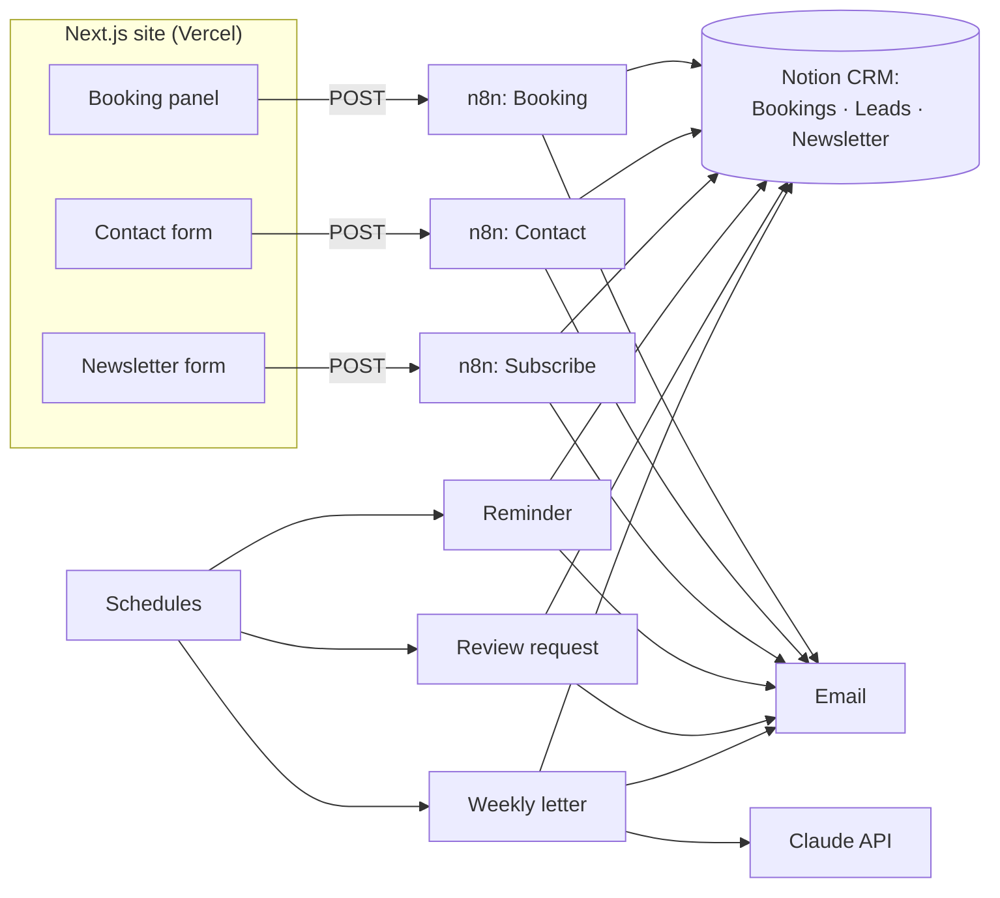

# Velure Med Spa — booking site with an n8n backend

A production-style reference build for an appointment-based service business: a single-page
Next.js site with a live booking panel, a contact form and a newsletter, backed entirely by
**seven n8n workflows** and a Notion CRM.

**Live demo:** https://velure-medspa.vercel.app

> Velure is a fictional brand created as a demo project by Thaus. The site accepts real
> submissions, so the footer, the booking consent and every email state that it is a demo.

## What it does

| Flow | Trigger | What happens |
|---|---|---|
| **Booking** | Webhook (POST) | Validate and normalise → bot checks → slot-conflict check in Notion → **409** if taken, otherwise create the booking, return **200** with `bookingId`, email the client and the owner |
| **Contact** | Webhook (POST) | Validate → create lead in Notion (Status *New*) → notify owner (reply-to = client) → auto-reply to client |
| **Subscribe** | Webhook (POST) | Validate → find subscriber → reactivate (duplicate) or create → **200** → wait 2 min → welcome email with signed unsubscribe link |
| **Unsubscribe** | Webhook (GET) | Verify HMAC token → mark *Unsubscribed* with date → branded HTML confirmation (unknown addresses get the same message, so the list is never revealed) |
| **Reminder** | Every hour | Confirmed bookings 1–24 h ahead without a reminder → send reminder → set `Reminder sent` |
| **Review request** | Daily 19:30 | Bookings marked *Completed* in the last 14 days → send review request → set `Review requested` |
| **Weekly letter** | Thursday 08:00 | Rotating topic → Claude writes the letter → output validated in code → sent to active subscribers |

## Architecture



## Engineering decisions

- **Spec-first.** `specs/velure_site_spec.json` and `specs/velure_booking_spec.json` are the
  single source of truth: brand, copy, motion, form rules and the request/response contract
  between the front end and the workflows. The front end never guesses the API.
- **No double bookings without a database server.** Every booking carries a `Slot key`; the
  workflow checks it against confirmed bookings before insert and returns **409**, which the
  UI turns into "That time was just taken".
- **Retry-safe schedules.** Reminder and review flags are set only *after* the email is sent,
  so a failed send is retried on the next run instead of being silently skipped.
- **Human in the loop where it matters.** *Completed* is set manually in Notion. Automating it
  would send thank-you emails to no-shows.
- **LLM output fails closed.** The weekly letter must have a title, an intro, exactly three
  headed points and a close, within 120–330 words; otherwise the run stops and nothing is
  sent. A manual trigger sends a preview to the owner only.
- **Layered bot defence.** Honeypot field, form-timing check (`elapsedMs`), origin allow-list
  on the webhook and an origin regex in the validate nodes.
- **Signed unsubscribe links.** HMAC token per address, so nobody can unsubscribe someone else.
- **Notion as the database.** The owner can read and correct every record by hand.

## Stack

Next.js (App Router) · TypeScript (strict) · Tailwind CSS v4 · shadcn/ui · GSAP (ScrollTrigger,
SplitText) · Lenis · react-hook-form + zod · n8n (self-hosted) · Notion · Claude API · Vercel.

## Repository layout

```
specs/      site and booking specifications (source of truth)
n8n/        the seven workflows (importable JSON) and backend setup guide
src/        Next.js app: sections, booking panel, forms, motion
scripts/    helper to download the generated media into public/media
CLAUDE.md   project rules used during AI-assisted development
```

## Running it

```bash
npm install
cp .env.local.example .env.local   # point the three webhook URLs at your n8n instance
npm run dev
```

Backend setup (Notion databases, credentials, secrets, tests) is described in
[`n8n/README-n8n.md`](n8n/README-n8n.md).

Workflow JSON files contain placeholders only (`REPLACE_ME`, `REPLACE_WITH_A_LONG_RANDOM_SECRET`,
`NOTION_*_DB_ID`, `owner@example.com`). Real credentials live in n8n's encrypted credential
store and in Vercel environment variables, never in this repository.

## Quality checklist

- Booking success → Notion record + client email + owner email; same slot again → 409 message.
- Contact → Notion lead + auto-reply + owner notification.
- Newsletter → Notion + welcome email after 2 min; repeat sign-up → "already subscribed".
- Unsubscribe link works; a tampered link shows "Link not recognised".
- Reduced-motion mode works without scroll pinning; Lighthouse mobile ≥ 90.
